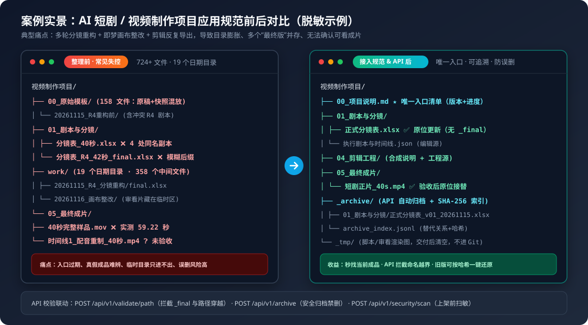

# AI 文件管理规范

通用版 2.1 · 2026-11-24

* **目标群体**：使用 Codex、Claude Code、ChatGPT、Cursor 及各类 AIGC 工作流进行多轮迭代的个人创作者、视频/内容团队与开发者。
* **核心作用**：适用于 AI 参与的 PPT、文档、表格、代码、图片、视频和工作流项目，解决多轮修改后版本失控、入口失效、临时文件堆积和误覆盖/误删问题，确保每次迭代都能接上已有成果，交付后也能立即找到当前版本。

**先找现有成果，再决定写到哪里。每种用途维护一个现行入口。每个新增的长期文件或目录，都要有能说清的用途。**

## 一、AI 写文件前的核查与分流

动笔前先核实 4 件事：**当前工作范围、可用的源文件、生成入口、期望交付物**。现有项目优先读它的说明、编辑源、现行成果和本次涉及的引用。日期、版本词和修改时间只用于定位候选。

| 本次需求 | 默认处理 | 例子 |
| --- | --- | --- |
| 修订同一成果 | 更新现有的可编辑文件或生成源。输出沿用原来的正式路径和名称。 | 修改 PPT 第 4 页图表；修正 Word 正文；修复网站表单。 |
| 重新生成同一成果 | 沿用已存在的构建入口、模板和资源。只重跑与改动有关的步骤，必要时重新导出同名成品。 | 复用当前 PPT 生成脚本导出整份 PPTX；复用现有工作流重新渲染镜头。 |
| 增加独立交付物 | 明确新增用途，使用项目已有目录。只有缺少适用位置时才建新目录。 | 给 PPT 额外导出 PDF；制作与完整版长期并行的 5 分钟路演版。 |
| 制作备选或试验 | 放入本次临时工作区或项目现有候选区。选定后才接替正式文件或登记为并行成果。 | 试两种封面；比较两种模型输出。 |
| 首次制作 | 在约定位置建立最小可用成果。有持续维护需要时再确定编辑源或构建入口。 | 一次性课程汇报交付一份 PPTX；长期更新的数据月报维护一个数据源和一个生成入口。 |
| 找不到原件，或有多个可信候选 | 先确认现行版本。可以继续做可独立验证的准备，在临时位置保存，并说明缺少的源文件或冲突。 | 名称都含“最终版”的三份 PPTX；只有 PDF，找不到可编辑的 PPTX。 |

每个长期新增项至少满足一项：**用户要交付、后续编辑或运行必需、已确认的历史恢复需要。** 其余生成中间结果由工具和临时工作区承担。源文件存在时，优先改其最小必要范围。功能或成果完全相同的第二套项目、脚本或源文件，只有确有独立用途时才成立。**正式文件严禁由 AI 自动追加 `_final`、`_最终版`、`_new`、`_fixed`、`_v2` 等模糊副本后缀。**

## 二、PPT 怎么做

| 你给 AI 的要求 | AI 使用什么 | 交付目录最终有什么 |
| --- | --- | --- |
| 做一份可编辑的环境工程课程汇报 | 现有模板，或在工具内首次创建可编辑演示文稿。渲染、检查和临时脚本集中处理。 | `环境工程课程汇报.pptx` |
| 改第 4 页图表和第 7 页结论 | 先打开现有 PPTX。可直接编辑时改指定页。若已有生成工程，则在原生成源中改对应内容，再导出。 | 同一个 `环境工程课程汇报.pptx`，并通过版本历史找上一版。 |
| 换整套视觉风格 | 以原 PPT、模板或原生成工程为基础，检查母版、图表、可编辑文本、图片与备注。批准保留双风格时，再明确两个用途。 | 同一文件名的新版，或用户要求并行的两份 PPT。 |
| 再给一份便于分享的 PDF | 由审核过的正式 PPTX 导出 PDF，检查页数和显示效果。 | 原 PPTX 加同名 PDF。 |
| 每月按 Excel 更新图表和数字 | 保留同一 Excel 数据入口、同一模板和同一生产脚本。逐月更新数据并导出。 | 项目已有位置下的一套可复用源文件和一份当前成品。 |

由脚本生成的 PPT 同时涉及**编辑源与导出件**。下次修改先确定谁是源文件。若项目用脚本和数据维护，就一起更新对应源和现行 PPTX。若平时直接在 PowerPoint 中编辑，就按现有 PPTX 续改并保留对象的可编辑性。临时渲染图、转换脚本和逐页截图留在临时工作区。验证以改动页为重点，同时抽查其它页、字体、图片、公式或链接，视交付要求检查播放或导出效果。

## 三、其它项目怎么套用

| 项目类型 | 先复用什么 | 哪些变化通常属于新增 |
| --- | --- | --- |
| Word、报告、论文 | 现稿、样式、编号、引用和项目的格式要求 | 经用户明确要求的摘要版、投稿版、PDF |
| Excel、数据图表 | 现有工作簿、工作表、公式、数据源及刷新路径 | 新用途的数据表或对外导出的静态图 |
| 代码、网站、自动化 | 原仓库、入口、模块、依赖和现有测试。先看已有函数与数据格式，再改最小必要范围 | 现有结构缺少且确需独立维护的模块、接口或交付物 |
| 图片、视频、可视化工作流 | 已批准的母图、素材、提示词、节点、剪辑工程和任务编号 | 明确并行的横版／竖版、不同用途裁切或正式新增镜头 |
| 只读问题、分析或解释 | 现有资料和当前会话 | 用户要求保存、分享或复用时，按需要输出对应文件 |

* **一次性任务按成果数组织**：只做一份 PPT 或文档时，直接交付成果即可。
* **长期项目用一个说明做入口**：列出各用途的现行路径、当前进度和历史位置。已有说明文件直接沿用，新建项目优先用 Markdown（如 `00_项目说明.md` 或 `README.md`）。业务目录已有合适位置时复用。
* **临时工作区集中且定时清理**：命令行工具生成的脚本、缓存、日志、导出预览和每轮过程目录，统一放入固定临时目录（如项目内 `_tmp/` 或统一的外部工作区），默认不纳入 Git 或同步盘。**本轮交付验收通过后清空临时目录，或仅保留最近一次调试产物（超 7 天可整目录清理）。**
* **无法直接写回的云端附件**：沿用同一正式名称，并在现有交付入口标明本次结果接替哪一版。

## 四、更新、归档和恢复

1. **找到正式件。** 结合项目说明、内容、任务记录和依赖定位对象。只有确认本次属于同用途修订，才接替当前件。用户原稿、上传素材、历史版本、剪辑工程等先辨明角色。
2. **确认可恢复（禁止静默物理删除）。** 项目已有 Git、平台版本历史或原生撤销机制时，使用已核实可用的历史。若没有可恢复版本，准备替换时只给本批实际受影响的正式文件备份一次，核实备份可用。**未经用户明确允许，AI 不得直接物理删除正式文件；需替换或下线时一律移入归档目录。** 试改、渲染和重复检查使用同一临时位置，本轮现场故障恢复暂存与长期历史分开处理。
3. **验证后接替。** 检查文件能打开、改动范围符合要求、相关引用能解析。现行文件若在过程中被别人或其它软件改动，重新对比后再写回。关联文件需要一起改时，记录旧状态及恢复位置，验证通过后再更新入口。
4. **更新已有入口。** 短交付直接发成品链接。长期项目在原有说明中记录当前路径、实际完成状态和历史位置。计划、已接入、已生成、已导出和验收分别描述。若中途失败，恢复已变动的正式文件，再报告失败范围与可用版本。

**本地归档约定：** 需要用本地文件保存历史时，放进项目统一的 `_archive/` 目录（纯人工阅读的非代码项目也可用 `旧版/`，避免全角括号和中英混排以免脚本/CLI 转义出错），按原相对目录保留层级。归档文件名统一为 `原文件主体_vNN_YYYYMMDD.原扩展名`。已有历史目录可先登记原位置和内容范围。归档索引至少记录用途、原路径、归档路径、时间、旧版序号、接替路径和原因；需要精确比对时记录 SHA-256。恢复时先保护现行版本，再恢复选定的一版并验证引用。对存量重复文件，字节相同只证明内容相同，后续处置还要结合用途与引用关系。

## 五、怎么让不同 AI 都执行

把下一节的短指令放进工具的**长期指令**，项目里的补充只写具体路径、模板、数据源和例外。已有说明或指令文件直接补充，通用细则只维护这一份。

| 工具 | 建议放置位置 |
| --- | --- |
| Codex | 用户级 `~/.codex/AGENTS.md`，已有生效的 `AGENTS.override.md` 时更新那份。仓库内已有 `AGENTS.md` 可补充本项目的现行路径和例外。 |
| Claude Code | 用户级 `~/.claude/CLAUDE.md`。仅对单项目适用的设置写进该项目现有指令。 |
| ChatGPT | 项目内用「项目设置 → 项目指令」。普通会话可使用自定义指令或把规则放在任务开头。 |
| 其它模型或一次性任务 | 通过该工具可用的长期指令（如规则文件）或任务开头传入短规则。 |

官方说明：[Codex 的 AGENTS.md](https://learn.chatgpt.com/docs/agent-configuration/agents-md)、[Claude Code 的项目与用户指令](https://code.claude.com/docs/en/memory)、[ChatGPT 项目指令](https://help.openai.com/en/articles/10169521-projects-in-chatgpt)。

日常验收只看三项：**能直接打开哪一份、实际改了什么、是否新增了长期文件。** 若新增，只列正式新增项与用途。涉及更新正式件时，再给一个可恢复的版本位置。连续修订同一成果时，如果成品名称、维护入口、目录数量均稳定，就达到了日常目标。

## 六、可直接交给 AI 的短指令

```text
写入文件前必须遵守以下规则：
1. 先查后写：先定位现行成品、可编辑源、生成入口和项目说明，再决定改动位置。
2. 原位更新：修订或重做同一成果时，在原编辑源/原生成入口做最小必要修改，输出沿用原路径和文件名；严禁自动新建 _final/_最终版/_new/_v2 等模糊副本。
3. 严控新增：仅当属于「用户要的新交付物 / 后续维护必需源文件 / 必要历史备份」时，才新增长期文件；临时脚本、渲染图、日志统一放临时工作区，同用途脚本与模板优先复用。
4. 先保后替：覆盖正式文件前确认可恢复（优先用 Git/平台历史，否则先移入归档目录）；未经明确允许不物理删除正式文件。
5. 冲突先报：若找不到源文件或存在多个候选版本，先列出候选并说明冲突，不盲目覆盖，先继续可独立完成的部分。

每次交付末尾固定汇报：
- 当前成品：<可直接打开的路径>
- 实际修改：<改动范围与内容>
- 新增/归档：<无，或列出新增长期文件用途 + 旧版恢复位置>
```

## 七、长期项目入口清单模板

新建长期项目时，可在根目录创建 `00_项目说明.md`，按需填写下表：

```markdown
# <项目名称> · 项目入口

更新日期：YYYY-MM-DD

| 用途 | 现行入口路径 | 编辑源 / 生成入口 | 当前状态 | 历史/归档位置 |
| --- | --- | --- | --- | --- |
| 核心成品 | `path/to/output` | `path/to/source` | 已验收 / 修改中 | `_archive/` |
| 辅助资料 | `path/to/ref` | 手动维护 | 现行 | — |
```

### 视频制作项目治理案例（脱敏示例）


