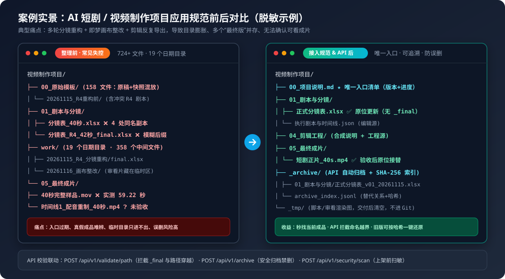

# AI 文件管理规范 & 安全校验 API

通用版 [AI文件管理规范.md](./AI文件管理规范.md)（v2.2）及其配套的 **FastAPI HTTP 安全校验接口**（v2.2.0），用于统一约束各类 AI Agent（Codex、Claude Code、ChatGPT、Cursor 等）在多轮迭代中的文件读写、原名归位、命名、归档与安全边界。

## 目标群体

* **多轮 AI 创作个人与团队**：高频使用 AI 制作 **短视频/短剧、PPT、报告论文、Excel 报表、可视化工作流** 的创作者，常被反复生成的 `_final`、`_v2`、日期目录和同名副本困扰。
* **AI 编程与 Agent 开发者**：使用 Codex、Claude Code、Cursor 等具备终端/文件写入权限的 AI 工具，希望在项目里建立“防路径越界、防静默误删、防文件失控”的硬边界。
* **多模型协作场景**：同时在多个 AI 工具之间接力完成同一项目，需要一套统一、可机器校验的文件交接标准。

## 核心作用

1. **消灭版本混乱**：同一用途只维护一个现行路径与入口，杜绝 `_final`、`_最终版`、`_v2` 等模糊副本爆炸。
2. **明确编辑源与导出件**：区分源工程/脚本与最终导出成品，每次迭代都能直接接上已有成果。
3. **守住安全边界**：通过 FastAPI 接口强制执行工作区沙箱隔离（防 `../` 路径穿越与符号链接逃逸）、禁止物理删除、归档自动计算 SHA-256 并记录索引。
4. **上架前自动扫敏**：内置敏感信息与硬编码本地路径扫描接口，避免把 API Key、私密草稿或本机路径误推到 Git 仓库。
5. **跨 AI 即插即用**：既提供可直接粘贴进任意 AI 工具的 5 条短指令，也提供标准 HTTP 接口供脚本与 Agent 自动调用。

## 实战案例：AI 视频 / 短剧制作项目

在 AI 参与的短视频/短剧制作中，常见痛点是：**分镜表多轮重构、画布整改目录与正式素材混放、最终成片目录出现多个时长不符的“样品”**。下图展示了将本规范与 API 引入视频制作项目前后的目录治理效果（已脱敏）：



## 安全边界设计

1. **工作区沙箱隔离**：所有路径操作强制限制在 `AI_FM_WORKSPACE_ROOT` 范围内，阻断 `../` 路径穿越、绝对路径访问、空字节注入及符号链接逃逸。
2. **命名红线拦截**：正式交付物禁止包含 `_final`、`_最终版`、`_new`、`_v2` 等模糊副本后缀，禁止全角括号及 Windows 保留设备名。
3. **禁止物理删除与失败自动回滚**：归档接口默认复制（可选移动）至 `_archive/`，写入 `archive_index.jsonl` 并校验 SHA-256，不提供删除接口；原名移动接口 `/api/v1/relocate` 只允许移入**现有目录**、保留原文件名与内容，并写入 `relocate_index.jsonl`。两类移动操作若在哈希校验或写索引阶段失败，都会**自动将文件移回原处**。
4. **用途识别与引用预览**：`/api/v1/relocate/preview` 在移动前自动识别文件角色（现行成果/源文件/素材/过程文件/归档/文档）、扫描工作区内的路径与文件名引用，输出「原位置 → 新位置」预览与冲突检测；存在未确认引用时默认拦截移动。
5. **敏感信息扫描**：内置上架前/提交前扫描接口，自动检测密钥/Token、硬编码本地绝对路径、手机号与邮箱。
6. **可选鉴权与本地绑定**：默认仅监听 `127.0.0.1`；设置环境变量 `AI_FM_API_KEY` 后，所有 `/api/v1/*` 接口强制校验 `X-API-Key` 请求头。

## 快速启动

```bash
python -m venv .venv
# Windows PowerShell:
.\.venv\Scripts\Activate.ps1
pip install -r requirements.txt

# 启动本地服务（默认仅监听本机）
uvicorn app.main:app --host 127.0.0.1 --port 8000
```

启动后访问交互式文档：`http://127.0.0.1:8000/docs`

## API 接口一览

| 方法 | 路径 | 说明 |
| --- | --- | --- |
| `GET` | `/health` | 服务健康检查 |
| `GET` | `/api/v1/spec` | 获取完整《AI 文件管理规范》正文与版本 |
| `GET` | `/api/v1/prompt` | 获取可直接复制给 AI 的短指令 |
| `POST` | `/api/v1/validate/path` | 校验目标路径与文件名是否符合安全边界与命名规范 |
| `POST` | `/api/v1/relocate/preview` | 识别文件用途、扫描引用关系并预览「原位置 → 新位置」（只读，不改文件） |
| `POST` | `/api/v1/relocate` | 保留原文件名与内容移入现有目录，校验 SHA-256、记录索引并支持失败自动回滚 |
| `POST` | `/api/v1/archive` | 安全归档指定文件到 `_archive/` 并生成 SHA-256 索引（移动模式支持失败自动回滚） |
| `POST` | `/api/v1/security/scan` | 扫描工作区内的密钥、硬编码本地路径及敏感信息 |

## 运行测试

```bash
pytest -v
```
